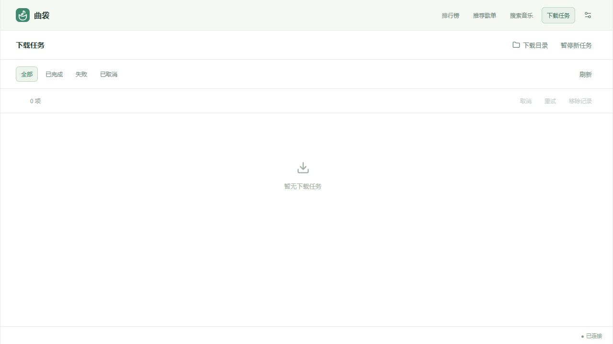

  

# 曲袋

把喜欢的歌曲装进口袋。

曲袋是一款轻量桌面音乐下载工具，将多平台搜索、批量下载和试听放进一个紧凑窗口。桌面端自带 music-service，启动应用即可连接本机服务。

## 主要功能

- **搜索与发现**：搜索歌曲、歌单、专辑和歌手，粘贴分享链接解析内容，也可浏览排行榜和推荐歌单。
- **批量下载**：勾选歌曲后统一下载，选择音质与降级策略；下载失败时，由服务严格匹配其他来源并尝试换源。
- **任务管理**：实时查看下载状态，支持多选、取消、重试和移除已结束的记录，也可暂停新任务的调度。
- **轻量试听**：播放音源、手动换源、随时停止，切换页面后继续播放，并显示实际播放平台。
- **平台账号**：配置 Cookie、切换账号，查看登录状态、会员类型和到期日期。可用平台与功能由服务提供。

## 获取与运行

跨平台预览版提供 Windows x64、Linux x64/ARM64、macOS Intel/Apple Silicon。请选择对应系统和处理器的包，保留解压后的完整布局。

前往 [v0.1.3 跨平台预览版](https://github.com/ddmoyu/music-dl/releases/tag/v0.1.3) 下载；[Windows 稳定版](https://github.com/ddmoyu/music-dl/releases/latest)继续保留。

| 系统    | 下载                                                                                                                                                                                                    |
| ------- | ------------------------------------------------------------------------------------------------------------------------------------------------------------------------------------------------------- |
| Windows | [EXE x64](https://github.com/ddmoyu/music-dl/releases/download/v0.1.3/qudai-win_x64.exe) · [ZIP x64](https://github.com/ddmoyu/music-dl/releases/download/v0.1.3/qudai-windows-x64.zip)                 |
| Linux   | [tar.gz x64](https://github.com/ddmoyu/music-dl/releases/download/v0.1.3/qudai-linux-x64.tar.gz) · [tar.gz ARM64](https://github.com/ddmoyu/music-dl/releases/download/v0.1.3/qudai-linux-arm64.tar.gz) |
| macOS   | [APP Intel](https://github.com/ddmoyu/music-dl/releases/download/v0.1.3/qudai-macos-x64.zip) · [APP Apple Silicon](https://github.com/ddmoyu/music-dl/releases/download/v0.1.3/qudai-macos-arm64.zip)   |

- **Windows**：需要 WebView2 运行时。EXE 可直接运行；ZIP 解压后包含同一个 EXE。
- **Linux**：以 Ubuntu 24.04 为基线，需要 GTK 3 与 WebKitGTK 4.1（`libwebkit2gtk-4.1-0`）。解压后运行 `start.sh`，不要单独移动 `qudai` 或 `service/`。
- **macOS**：最低 macOS 15。解压后将 `曲袋.app` 拖入应用程序目录，当前仅 ad-hoc 签名，尚无 Developer ID 签名或公证。

无需另外安装 Node.js 或后端服务。运行配置和服务数据保存在系统用户目录，压缩包便携分发不表示所有数据都保存在程序旁。

Release 中提供 `SHA256SUMS` 与构建报告，供核对下载文件。从源码运行与打包见[开发与打包说明](docs/development.md)。

## 快速使用

1. 打开应用，在“搜索音乐”中输入关键词或粘贴分享链接，也可以从“排行榜”或“推荐歌单”进入详情。
2. 需要调整音质或配置平台账号时，打开右上角“设置”。
3. 在歌曲列表点击试听按钮播放；勾选已加载的歌曲，点击“下载所选”批量提交。
4. 在“下载任务”查看进度、取消任务或重试失败项；点击“下载目录”打开保存位置。

## 界面预览

截图来自正式前端的浏览器开发模式，连接真实本机服务；仅展示空界面，不含歌曲、歌手、封面或下载记录。桌面窗口使用相同界面，布局随窗口宽度调整。

**搜索音乐**

**下载任务**

## 使用须知

- 试听和下载取决于音源可用性、版权及账号授权；搜索结果与付费标记不保证可播放或下载。请仅下载你有权获取和使用的内容。
- 批量下载针对当前已加载的所选歌曲。“暂停新任务”不影响正在执行的任务，目前不支持单任务暂停；“移除记录”只隐藏本机列表中的记录，保留音乐文件和后台历史。
- 新配置默认保存至系统音乐目录下的 `曲袋/`。配置与服务数据位于系统应用数据目录的 `shiyin/`，已有配置保留原下载路径。更改下载根目录需关闭应用后编辑 `service.json`。
- 不要同时打开多个使用同一数据目录的窗口。升级旧开发版本前，请先阅读[数据与兼容性说明](docs/development.md#开发和运行)；旧服务数据库不会自动迁移。

## 文档与反馈

- [开发、运行与打包](docs/development.md)
- [更新日志](CHANGELOG.md)
- [问题反馈与功能建议](https://github.com/ddmoyu/music-dl/issues)

正式应用采用原生 HTML、CSS、JavaScript ES Modules、Vite 与 Neutralinojs。`prototype/` 仅供设计参考，独立运行，不进入正式发行包；详见[原型说明](docs/prototype.md)。
