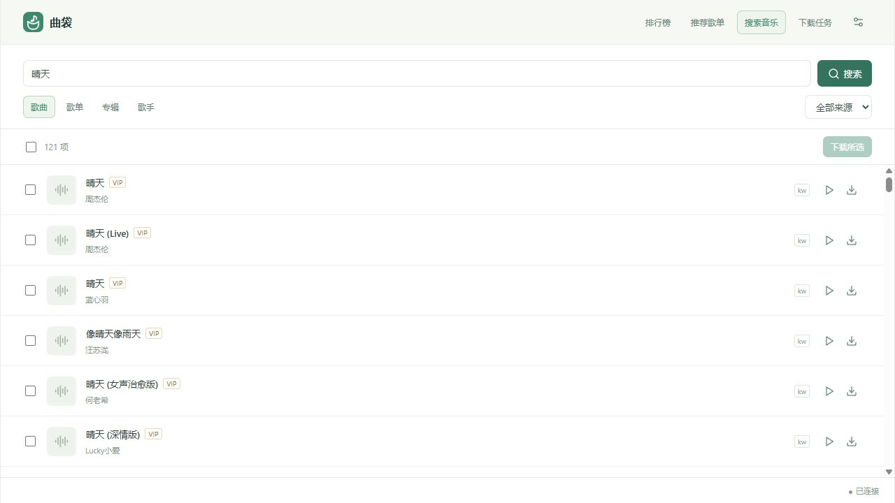
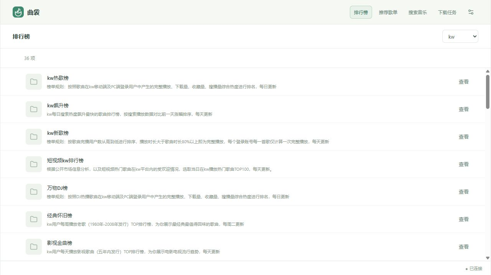

<p align="center">
  
</p>

# 曲袋

把喜欢的歌曲装进口袋。基于 music-service 的轻量桌面音乐下载工具，支持多平台搜索、批量下载和试听，使用原生 HTML、CSS、JavaScript ES Modules、Vite 与 Neutralinojs 构建。

正式应用位于 `src/`，连接真实 music-service，桌面端自带服务并自动启动。目前验证的桌面平台为 **Windows x64**。

## 功能

- **搜索与发现**：搜索歌曲、歌单、专辑和歌手，解析分享链接，浏览平台排行榜和推荐歌单。可用来源与能力由服务动态提供。
- **批量下载**：选择已加载的歌曲分批提交，支持音质、降级策略与授权下载目标选择；断连后确认原请求，避免重复创建任务。
- **下载管理**：实时同步任务状态，支持多选、右键菜单、取消、失败重试和移除终态记录；支持暂停新任务。
- **轻量试听**：切换页面继续播放，可随时停止或手动换源，显示实际播放平台。
- **下载换源**：失败后由后端严格匹配并尝试其他来源，显示原平台、实际平台及已尝试来源。
- **账号管理**：配置平台 Cookie，管理账号的校验、启停、切换与删除，查看登录状态、会员类型和到期日期。

## 界面截图

以下截图来自正式前端的浏览器开发模式，连接真实 music-service；桌面窗口使用相同界面，并可按窗口宽度调整布局。平台内容随服务实时变化。

**搜索音乐**



**浏览排行榜**



## 本地开发

需要 Node.js 24、pnpm 12.14.0，以及 **music-service 0.1.30（schema 8）**。先构建后端 `music_service_server`，确保 `MUSIC_SERVICE_PROVIDERS` 包含所需平台，且服务支持 `--parent-pid`。

```powershell
pnpm install
pnpm desktop:setup

# 替换为自己构建并安装的后端路径。
$env:MUSIC_SERVICE_BINARY = '<后端安装目录>/bin/music-service.exe'
pnpm desktop:prepare

pnpm dev
```

打开 <http://127.0.0.1:5175/>。Vite 自动启动真实服务，开发数据保存在 `.tmp/development-service-<port>/`，与桌面数据分开。普通静态预览无法启动本机服务。

使用桌面窗口运行：

```powershell
pnpm desktop:dev
```

## 常用命令

| 命令                   | 用途                             |
| ---------------------- | -------------------------------- |
| `pnpm dev`             | 启动正式前端与真实开发服务       |
| `pnpm desktop:setup`   | 安装配置指定的 Neutralino 运行时 |
| `pnpm desktop:prepare` | 准备并校验后端二进制版本         |
| `pnpm desktop:dev`     | 构建正式页面并启动桌面窗口       |
| `pnpm check`           | 检查格式、运行正式应用测试并构建 |
| `pnpm desktop:build`   | 生成 Windows x64 单文件发行包    |

## Windows x64 打包

后端先通过 `cmake --install <构建目录> --prefix <安装目录>` 生成可执行文件与第三方许可证，然后运行：

```powershell
pnpm desktop:setup
$env:MUSIC_SERVICE_BINARY = '<后端安装目录>/bin/music-service.exe'
$env:MUSIC_SERVICE_LICENSES = '<后端安装目录>/share/music-service/licenses'
pnpm desktop:build
```

输出为 `release/qudai-windows-x64/qudai-win_x64.exe` 和 `release/qudai-windows-x64.zip`。EXE 内嵌正式页面、后端服务与第三方许可声明，可以单独复制运行；系统需要 WebView2 运行时。macOS 和 Linux 尚未打包验收。

打包脚本在独立的 `.desktop-build/` 目录执行。**不要在仓库根目录直接运行 `neu build` 或 `neu update`**，它们会归档并清理 `.tmp/`。

## 使用边界与数据

- 是否能够试听或下载取决于实时音源和账号授权，搜索结果不代表拥有播放或下载权限。付费标记来自服务；解析、权限及下载错误会如实显示。
- “暂停新任务”调整后台调度，正在执行的任务继续运行；目前不支持单任务暂停。“移除记录”仅隐藏本机列表，保留音乐文件和后台历史。
- 目录每列表最多缓存 5000 项，批量下载针对已加载的所选歌曲；下载任务列表会取完全部分页，不受该缓存上限限制。
- 桌面配置、数据库和服务缓存保存在系统应用数据目录的 `shiyin/`；新配置默认下载至系统音乐目录下的 `曲袋/`，已有配置保留原下载路径。
- 修改下载根目录和输出布局，需要关闭桌面端后编辑 `service.json`。不要同时启动多个使用同一数据目录的窗口。
- schema 8 不自动迁移旧服务数据库。升级旧开发版本前，请阅读[数据与兼容性说明](docs/development.md#开发和运行)，其中清理旧数据的操作会删除账号、Cookie 和任务记录。

## 项目结构

```text
src/          正式应用
public/       正式静态资源与品牌图标
scripts/      本机服务、桌面构建与品牌资源脚本
tests/        正式应用测试
docs/         开发说明与真实界面截图
prototype/    独立设计原型
```

`prototype/` 仅供设计参考，通过 `pnpm prototype:dev`、`pnpm prototype:build` 和 `pnpm prototype:test` 独立运行，不从正式入口导入，也不进入发行包。

更多细节见[开发、打包与运行细节](docs/development.md)和[原型说明](docs/prototype.md)。Logo 的唯一矢量源为 `public/favicon.svg`，构建时自动生成窗口与 EXE 所需的 PNG 图标。
